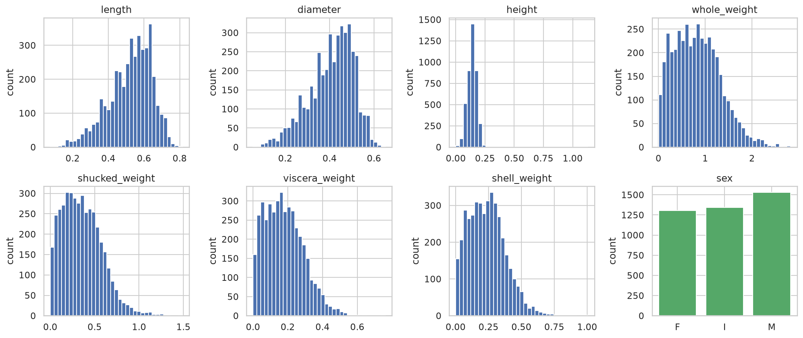
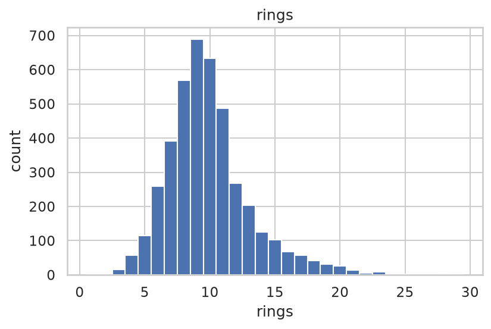
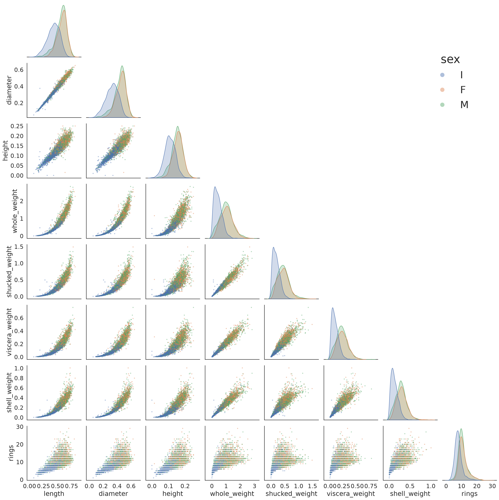
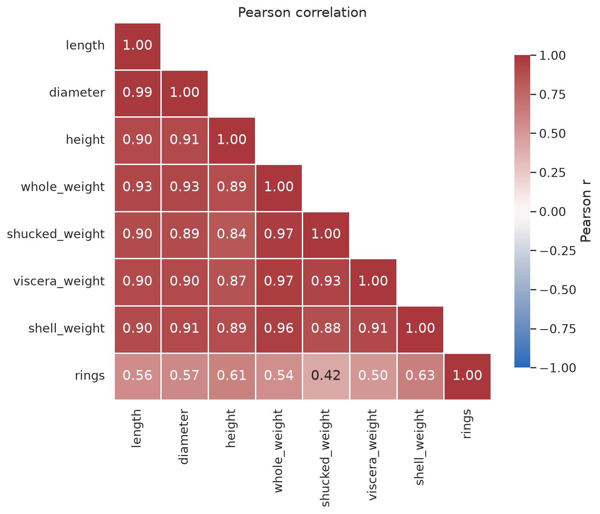
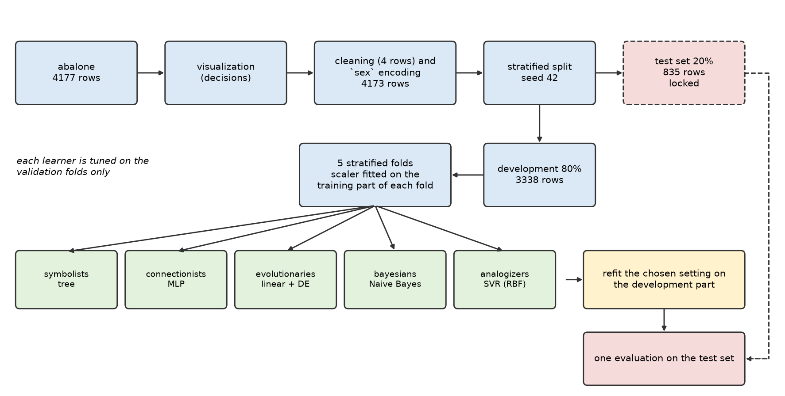
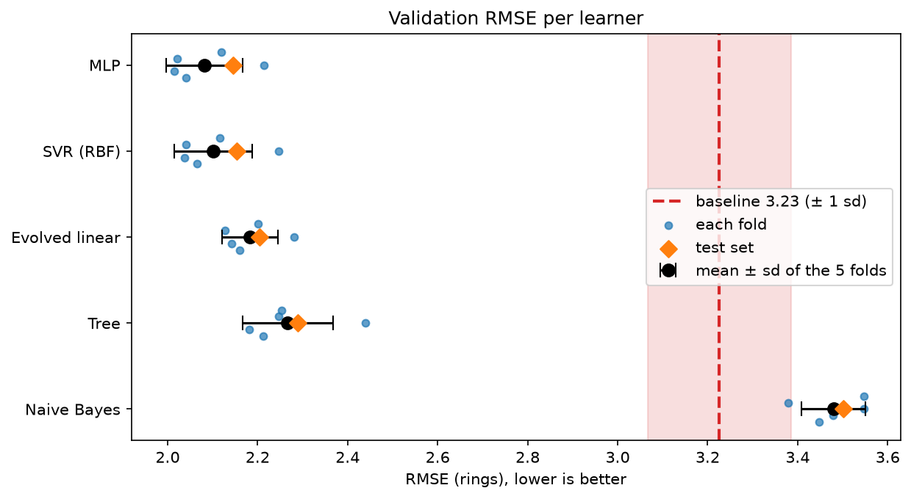
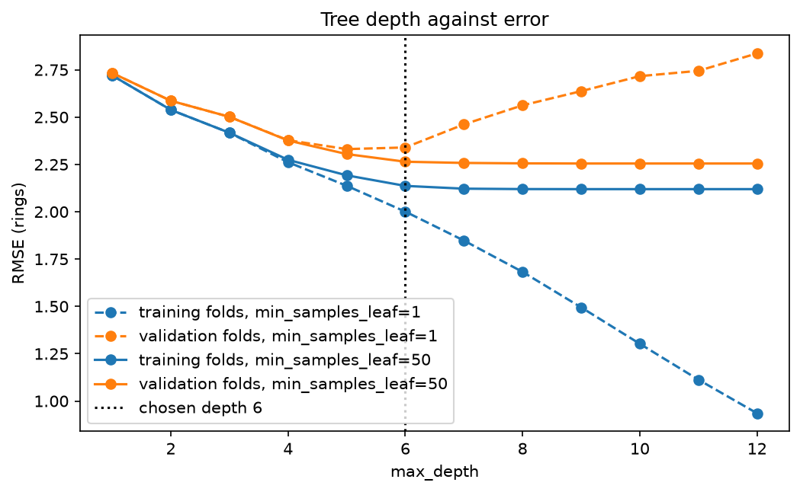
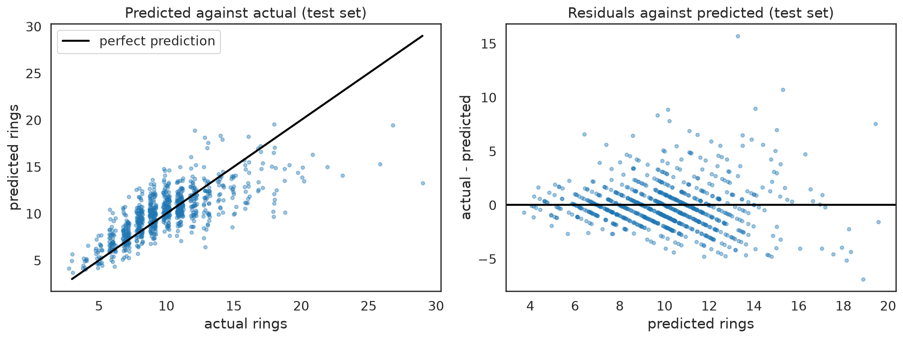

# Project 1: The Five Classes of Learners

## 1. Identification

Gonçalo Fonseca - 118920
Course: FAA
Date: 4/11/2026
Dataset and task: `abalone`, regression (target `rings`)

**How to run.** Create the environment with `make venv` and open the notebooks with it. Run them from this folder, in this order, each from top to bottom:

1. `visualization.ipynb`: the data visualization (Section 3).
2. `methology.ipynb`: cleaning, split, folds, metrics and baseline (Section 4).
3. The five learners, in any order (they are independent and each saves `results/<class>.npz`): `symbolts.ipynb`, `connectionists.ipynb`, `evolutionarie.ipynb`, `bayesians.ipynb`, `analogizers.ipynb` (Section 2).
4. `evaluation.ipynb`: the comparison, the diagnostic and the error analysis (Section 5). It only reads the five `results/*.npz` files, so it must run last.

Every seed is fixed (42). The Keras learner uses the JAX backend (`KERAS_BACKEND=jax`, set inside the notebook).

## 2. Models

The five learners, one per class (notebook in brackets). All use the same folds and the same 9 standardized features from Section 4.

**Preprocessing per learner.** The tree does not need standardization (its splits do not depend on the scale) but gets it so that all learners receive identical inputs. The MLP and the SVR also standardize `rings` (mean and standard deviation of the training part): the MLP so that its output layer starts on a sensible scale, the SVR because the RBF kernel works on distances between animals and `epsilon` and `C` are easier to set on a unit scale. The evolved linear model uses the standardized features so that the weights are small and comparable and fit the search bounds of the evolution. Naive Bayes uses the same standardized features; only its PCA variant adds a PCA (fitted on the training part), to explain the failure.

| Class | Learner | Why for `abalone` | Hyper-parameters and search | Cost |
|:--|:--|:--|:--|:--|
| Symbolists (`symbolts`) | Regression tree: rules of the form `shell_weight <= t`, the prediction is the mean `rings` of the leaf | readable rules; does not care about the correlated features | `max_depth` {2, 3, 4, 5, 6, 8, 10} × `min_samples_leaf` {1, 5, 20, 50}: 28 settings, grid | 140 fits, under a second each |
| Connectionists (`connectionists`) | MLP in Keras (JAX), Adam, MSE, backpropagation, early stopping on 20% of the training part | can bend to the curved relation between weights and age | `units` {(16), (32), (32, 16), (64, 32)} × `activation` {relu, tanh, softplus} × `lr` {0.001, 0.01} × `l2` {0, 0.001}: 48 settings, grid | 240 fits, the slowest learner |
| Evolutionaries (`evolutionarie`) | Linear model `w · x + b` whose 10 values are evolved by differential evolution (`pyBlindOpt`), scored by the training RMSE | the evolution is the way the model is learned | none: population 50, 100 generations | 5 × 5000 evaluations |
| Bayesians (`bayesians`) | Naive Bayes for regression: `rings` has a Gaussian prior and each feature is Gaussian around a line of `rings`; the posterior is Gaussian | tests the independence assumption on features that are almost copies of each other | none (closed form); a PCA variant is used only to explain the result | instant |
| Analogizers (`analogizers`) | SVR with an RBF kernel: the prediction is a weighted sum of the similarities to the support vectors | similar animals have similar ages; the kernel gives a smooth non-linear fit | `C` {0.3, 1, 3, 10} × `gamma` {0.01, 0.03, 0.1, 0.3} × `epsilon` {0.05, 0.2, 0.5}: 48 settings, grid | 240 fits, under a second each |

Chosen settings (simplest within one standard error, Section 4): tree with `max_depth` 6 and `min_samples_leaf` 50 (35 leaves); MLP with one layer of 16 relu units, `lr` 0.01, `l2` 0 (177 weights); SVR with `C` 10, `gamma` 0.1, `epsilon` 0.5 (about 890 support vectors). The grids are flat near the top: many settings are within the fold noise.

## 3. Dataset

**Choice.** I chose a regression task because i worked with classification before and wanted to try regression and `abalone` because its topic seemed interesting to me.

**Task and target.** Predict the number of shell rings (`rings`, age in years ≈ rings + 1.5) of an abalone from its sex and seven physical measurements. Counting rings means cutting the shell, which is slow and destroys the animal. The measurements are quick and cheap. A good model is judged by how many rings it is wrong by.

**Size and features.** 4177 animals (4173 after cleaning) and 8 features: `sex` (M, F or I for infant) and 7 numeric ones: `length`, `diameter`, `height`, `whole_weight`, `shucked_weight`, `viscera_weight` and `shell_weight`. There are no missing values and no duplicated rows.

**Data visualization** (code in `visualization.ipynb`; every figure led to a decision in Section 4).

*Figure 1. Histogram of each feature and the count of each `sex`. The seven measurements are positive and on different scales, the weights are right-skewed, `length` and `diameter` are left-skewed. `sex` is balanced. Decision: standardize, and encode `sex`.*

*Figure 2. The target `rings`: an integer from 1 to 29, mean 9.93, median 9, with a right tail (skew 1.11) and no pile-up at the maximum. Decision: RMSE as the main metric and MAE as a second one, because a few old animals dominate the RMSE.*

*Figure 3. Features against each other and against `rings`, coloured by `sex` (the 2 extreme `height` rows removed). Infants are smaller and have fewer rings; females and males overlap. The size and weight features move together, curved against the weights, and the spread grows with size. Decision: expect larger errors for big and old animals, and encode `sex` as `is_infant` and `is_female`.*

*Figure 4. Pearson correlation. `length` and `diameter` have r = 0.99 and the four weights 0.88 to 0.97 among themselves, while each feature has only 0.42 to 0.63 with `rings`. Decision: the features are nearly one variable, which matters for Naive Bayes.*

**Hypotheses.** Before fitting, the figures suggest three:

- Naive Bayes does badly, because the features are strongly dependent (Figure 4)
- the non-linear learners beat the linear ones, because the weights are curved against the size (Figure 3)
- the errors are larger for old animals, because the spread grows with size (Figure 3)

**Source.** Nash, W., Sellers, T., Talbot, S., Cawthorn, A., & Ford, W. (1994). *Abalone* [Dataset]. UCI Machine Learning Repository. <https://doi.org/10.24432/C55C7W>. Licensed under CC BY 4.0. The copy used here is the one distributed with the course (`data/abalone.csv.zst`, columns renamed).

**Scaling of the values.** The authors divided the continuous values by 200 "for use with an ANN" (UCI documentation), so they are not in mm or grams. This changes the scale only, not the shapes or correlations.

## 4. Methodology

All the choices below are implemented in `methology.ipynb`.

*Figure 5. The pipeline. The test set is split off before anything is fitted and is used once at the end. The scaler is fitted on the training part of each fold. Each learner is tuned on the validation folds only, and the chosen setting is refitted on the development part.*

**Data cleaning.** Four rows are removed because `height` is impossible: `height` = 0 (2 rows) or `height` > 0.3 (2 rows, 0.515 and 1.13; the next largest is 0.25). This leaves 4173 rows. The rule uses no statistic learned from the data, so applying it before the split cannot leak.

**Split.** 20% of the rows (835) are held out as a test set, used once at the end. The split is stratified on 5 quantile bins of `rings`, so the thin tail of old animals appears in both parts. The other 3338 rows are the development part.

**Folds.** 5-fold cross-validation on the development part, stratified on the same bins, about 667 validation rows per fold. All learners use the same folds, so they can be compared fold by fold.

**Metrics.** RMSE (main) and MAE, both in rings, and R². `rings` has a long right tail, so RMSE is driven by a few old animals while MAE is less sensitive to them. R² is the fraction of the variance of `rings` that the model explains: 0 for the mean baseline, 1 for a perfect model.

**Baseline.** Predict the mean of `rings` of the training part of each fold: RMSE 3.226 ± 0.159, MAE 2.366 ± 0.084, R² −0.001 ± 0.001 (slightly below 0 because the validation mean differs a little from the training mean). On the test set, the mean of the whole development part scores RMSE 3.207, MAE 2.351 and R² −0.0001 (this is the baseline's single use of the test set).

**Spread.** Results are the mean and standard deviation over the 5 validation folds. The baseline's fold-to-fold standard deviation (0.159 in RMSE) is the noise level: a smaller difference between two learners is not treated as real.

**Preprocessing.**

All 9 features (including the 2 binary ones below) are standardized with the mean and standard deviation of the training part of each fold, and applied unchanged to its validation part.

`sex` becomes two binary columns, `is_infant` and `is_female`. Infants have far fewer rings (7.9 on average) than females (11.1) and males (10.7), while females and males differ by only 0.4, and two columns avoid the redundancy of three one-hot columns. This is a fixed rule that learns nothing from the data, so it is applied before the split, like the cleaning.

**Tuning.** Hyper-parameters are chosen on the 5 validation folds only. Among the settings whose mean validation RMSE is within one standard error of the best one (its fold standard deviation divided by √5), the simplest one is chosen (the smallest model: the fewest weights for the network, leaves for the tree, support vectors for the SVR). That setting is refitted on the whole development part and evaluated once on the test set. The search space, method and cost of each learner are in Section 2.

**Leakage.**

* The test set is split off before any model is fitted and is touched once.
* The scaler is fitted on the training part of each fold only.
* The only steps before the split are the cleaning rule and the `sex` encoding, which learn nothing from the data.
* Hyper-parameters are tuned on the validation folds, never on the test set.
* The stratification bins only build the split; they are not a feature.

## 5. Evaluation and conclusion

**Results.** Mean ± standard deviation over the 5 validation folds, and the single score on the test set (835 rows).

| Learner | Validation RMSE | Validation MAE | Validation R² | Test RMSE | Test MAE | Test R² |
|:--|:--|:--|:--|:--|:--|:--|
| Baseline (mean) | 3.226 ± 0.159 | 2.366 ± 0.084 | −0.001 ± 0.001 | 3.207 | 2.351 | −0.000 |
| Symbolists: tree | 2.267 ± 0.101 | 1.612 ± 0.033 | 0.505 ± 0.026 | 2.289 | 1.595 | 0.491 |
| Connectionists: MLP | 2.082 ± 0.085 | 1.492 ± 0.031 | 0.582 ± 0.029 | 2.145 | 1.510 | 0.552 |
| Evolutionaries: evolved linear | 2.183 ± 0.062 | 1.576 ± 0.019 | 0.540 ± 0.032 | 2.205 | 1.606 | 0.527 |
| Bayesians: Naive Bayes | 3.480 ± 0.071 | 2.803 ± 0.046 | −0.170 ± 0.101 | 3.501 | 2.858 | −0.192 |
| Analogizers: SVR (RBF) | 2.101 ± 0.087 | 1.494 ± 0.023 | 0.575 ± 0.027 | 2.154 | 1.500 | 0.549 |

*Figure 6. Validation RMSE of the five learners: each fold (blue dots), mean ± standard deviation (black) and the test score (orange diamond). The red line is the baseline with its ±1 standard deviation band. The MLP, the SVR and the evolved linear model overlap; the tree is slightly worse; Naive Bayes is worse than the baseline. The test scores sit inside the fold spread.*

**Conclusion.**

* Four learners clearly beat the baseline (RMSE 2.1 to 2.3 against 3.2). Naive Bayes is worse than the baseline.
* The MLP and the SVR are tied (validation 2.082 and 2.101, test 2.145 and 2.154): the difference is far below the fold noise of about 0.09. The two non-linear learners are about 0.1 RMSE better than the evolved linear model (2.183), which is also about the size of the noise, so the evidence for non-linearity is weak. With a linear kernel the SVR gets 2.190.
* The evolved linear model (2.183) is close to the two non-linear learners and better than the tree: differential evolution finds a good linear solution, at a much higher cost (5 × 5000 evaluations) than a closed-form fit would need.
* The tree is the weakest of the four (2.267), but it is the only one that is readable: 80% of its importance is on `shell_weight` (rules in `figures/tree_rules.png`). Figure 7 shows why its leaf size matters: with 1 sample per leaf the tree overfits after depth 5, and with 50 the validation error stays flat at 2.26.
* Naive Bayes fails because the features are not independent (Section 3: size features correlate 0.88 to 0.99). It counts the same information several times. After PCA, which removes the correlation, it gets 2.264.
* The ranking on the test set is the same as on validation, and no learner is chosen from the test result.

*Figure 7. Tree depth against error (RMSE, mean of the 5 folds). With `min_samples_leaf=1` (dashed) the training error keeps falling while the validation error turns up after depth 5: the tree overfits. With the chosen `min_samples_leaf=50` (solid) the tree cannot grow much beyond depth 6 and the validation error stays flat at 2.26.*

**Diagnostic of the best learner (MLP).**

*Figure 8. MLP on the test set. Left: predicted against actual rings; the predictions stay between about 4 and 20 and flatten for old animals. Right: residuals (actual − predicted) against predicted rings; the spread grows with the prediction, and the points fall on diagonal lines because the rings are integers.*

**Error by age.** MAE on the test set by the actual rings of the animal:

| Actual rings | Animals | MLP | SVR | Evolved linear | Tree | Naive Bayes |
|:--|:--|:--|:--|:--|:--|:--|
| ≤ 7 | 175 | 1.12 | 1.08 | 1.17 | 1.15 | 2.25 |
| 8 to 10 | 356 | 1.30 | 1.27 | 1.33 | 1.36 | 2.63 |
| 11 to 13 | 216 | 1.37 | 1.36 | 1.56 | 1.39 | 3.25 |
| ≥ 14 | 88 | 3.47 | 3.62 | 3.70 | 3.94 | 4.02 |

The four working learners are about 2.5 to 3.5 times worse on the 88 oldest animals (10% of the test set) than on the 8 to 10 rings group; Naive Bayes is bad everywhere. The MLP's mean residual is +3.2 rings for them (it underestimates their age) and about −0.9 for the animals up to 10 rings (it overestimates): the predictions are pulled towards the mean.

**Answer to the hypotheses.**

- Confirmed: Naive Bayes is worse than the baseline (3.480 against 3.226) and recovers to 2.264 after PCA.
- Weakly supported: the MLP and the SVR are about 0.1 RMSE better than the linear model, which is about the size of the fold noise (0.09).
- Confirmed: the error for the oldest animals is more than twice that of the others, for the four working learners.

**Limits**

- The target is noisy: the best learners explain only about 55% of the variance of `rings` (R² 0.55) and are wrong by about 1.5 rings on average.
- The comparison rests on one split. The test set has 835 animals and gives a single number per learner, with no interval, and the fold standard deviation (about 0.09 RMSE) is as large as the gap between the MLP, the SVR and the evolved linear model. The order among these three is therefore not reliable; only "these three are better than the tree, and all are better than the baseline" is.
- The four working learners make errors 2.5 to 3.5 times larger on the 88 oldest animals than on the middle group. For the MLP, the mean residual is +3.2 rings for them (it underestimates) and about −0.9 for the young ones (it overestimates), so its predictions are pulled towards the mean. No learner here fixes this.

**What I would do next**

- Replace the single hold-out by repeated stratified cross-validation and compare the models fold by fold, since all use the same folds.
- Model the target differently: predict `log(rings)` and check whether the error for the oldest animals shrinks.
- Remove redundant features (`length` against `diameter`, the four weights) and test whether Naive Bayes recovers without PCA, which would confirm that the dependence is the cause of its failure.
- Search the MLP and the SVR more widely (random search, several seeds) and see whether the 0.1 RMSE advantage over the linear model is real.
